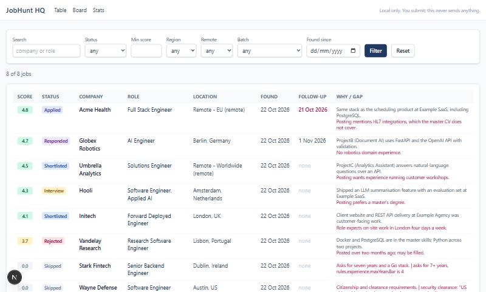
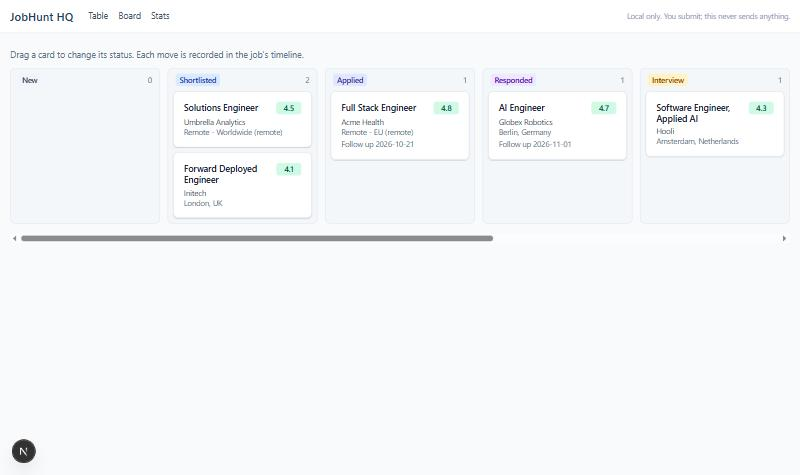

# JobHunt HQ

**An open-source, Claude Code native job-search kit.** Describe yourself once. Claude Code finds roles you can realistically get, scores them honestly, tailors a truthful two-page CV and cover note for each, helps fill application forms without ever submitting, and tracks everything in a local dashboard.



> Built from a real three-week test run: 509 roles tracked across 378 companies, 132 tailored CVs, 53 applications, 8 responses. This repo turns that workflow into something anyone can run with their own preferences.

## Why
Most job tools match keywords. JobHunt HQ filters for what actually blocks you (visa, location, years bar, language, clearance) and tells you the gap before you spend an hour on an application. Everything it writes comes from your own master CV, and every sentence it cannot trace back is listed for you to verify.

## Quick start
You need Node 22, pnpm 12, [Claude Code](https://claude.com/claude-code), and LibreOffice for PDF rendering (the kit tells you when it is missing).

```bash
git clone https://github.com/teeps-heisenberg/jobhunt-hq.git
cd jobhunt-hq
pnpm install
pnpm jh doctor      # what is set up, what is missing
```

Then open Claude Code in the folder and run the skills in order:

| Step | Skill | What happens |
|---|---|---|
| 1 | `/setup` | Imports your CV (DOCX or PDF), interviews you, writes `config/profile.yaml`, `config/rules.yaml` and `data/master.json`, validates them. |
| 2 | `/search [focus]` | One scout agent per source group searches official careers pages and public ATS boards in parallel. The CLI dedupes, scores and stores the rows. |
| 3 | `/score <id or URL>` | Scores one posting against your rules: hard blockers first, then a 0 to 5 number with why and gap. |
| 4 | `/tailor <id>` | Builds a variant of your master CV for the role, renders DOCX and PDF, checks the page count and style, flags every new claim. |
| 5 | `/pack <id>` | Writes `output/<company>/<role>/pack.md`: cover note, why this role, screening answers from your rules, and the verify list. |
| 6 | `/apply <id>` | Opens the form in a browser, fills the fields it knows, and stops. You attach files, tick boxes and submit. |
| 7 | `/followups` | Lists due follow-ups and drafts short messages. You send them. |

Meanwhile `pnpm dev` runs the dashboard on http://localhost:3000. Just looking? `pnpm demo` starts it on a throwaway database filled with fictional data.



## How it works
```
Claude Code (your terminal)
  ├─ .claude/skills/*      the workflows: setup, search, score, tailor, pack, apply, followups
  ├─ .claude/agents/*      subagents: job-scout (one per source group), claim-checker
  ├─ Playwright MCP        fills application forms, never submits
  └─ pnpm jh <command>     everything that must be exact and repeatable
        ├─ packages/core    zod schemas, scoring, dedupe, SQLite tracker (Drizzle), the CLI
        ├─ packages/resume  master CV schema, variant builder, DOCX, PDF, page check, style lint
        └─ apps/dashboard   Next.js on the same SQLite file: table, kanban, job pages, stats

config/   profile.yaml, rules.yaml     your preferences (git-ignored; *.example.yaml committed)
data/     master.json, jobhunt.db      your CV and tracker (git-ignored)
output/   <company>/<role>/            cv.docx, cv.pdf, cover.docx, pack.md (git-ignored)
```

The split is deliberate. The language model does judgment: reading postings, writing why and gap lines, choosing which bullets to lead with. The TypeScript CLI does everything that must be exact: validation, dedupe, the score, database writes, rendering, page counts, the style lint. Skills call the CLI; they never hand-edit the database or make up a number.

## Safety principles
- **You submit.** The kit never clicks Submit, Send or Apply, never ticks consent or terms boxes, never types passwords, national IDs, dates of birth or payment details. A Playwright test against Greenhouse, Lever and Ashby style forms proves the filler never submits.
- **No invented claims.** CVs and notes are generated only from `data/master.json` and `config/profile.yaml`. Anything new is listed under "Verify before sending", and a claim-checker agent reviews every sentence.
- **Local first.** Your profile, CV, tracker and generated files stay on your machine. A test asserts they are git-ignored.
- **Plays fair.** Official careers pages and public ATS boards only. No login-walled scraping, no CAPTCHA solving, no LinkedIn automation, no bulk auto-apply. A daily application cap lives in your rules.
- **Respects employers' AI rules.** If a posting says not to use AI for answers, the kit says so and does not write them.

## Configuration reference
All three files are yours and git-ignored. Start from the examples in `config/` and `data/examples/`; `pnpm jh doctor` validates them.

### `config/profile.yaml`
| Field | Meaning |
|---|---|
| `name`, `contact.email`, `contact.phone`, `contact.location`, `contact.links` | As they should appear on applications. |
| `citizenship` | Countries or blocs (`EU`) where you can work without sponsorship. |
| `yearsExperience` | The number you would give on a screening form. |
| `languages` | `{name, level}` with level `basic`, `conversational`, `professional`, `fluent` or `native`. |
| `targetTitles` | Three to six titles the scouts search for. |
| `noticePeriod`, `currentSalary`, `targetSalary` | Used in screening answers. Optional. |
| `neverClaim` | Things you do not want claimed even if a posting asks for them. |

### `config/rules.yaml`
| Field | Meaning |
|---|---|
| `locations.remoteFrom` | Where you can take remote roles (countries or `EU`). |
| `locations.relocate` | Cities you would move to. |
| `locations.exclude` | Never, for example where a visa is unrealistic. |
| `visa.needsSponsorshipOutside` | Blocs where you do not need sponsorship, for example `[EU]`. |
| `visa.skipIf` | Phrases that mark a hard blocker, such as `citizenship required`. |
| `experience.maxYearsBar` | Skip roles asking for more years than this. |
| `hardBlockers.languagesRequired` | Languages that block a role when fluency is required and your profile lists you below professional. |
| `recencyDays` | Ignore postings older than this. |
| `salary` | Bands per location key (`remote`, a city or a country), free text such as `EUR 50-60K`. Used for the salary factor and screening answers, always with "flexible". |
| `style.maxPages`, `style.bannedCharacters`, `style.bannedPhrases`, `style.projectOrder` | CV page target (exact), banned characters (the em dash by default) and phrases, default project order. |
| `caps.dailyApplications`, `caps.<company>` | Application caps, for example `google: {applications: 3, perDays: 30}`. |
| `sources` | `bigTech`, `ats` (board names), `remote` (sites), `research`, `custom` (your boards). |
| `scoring.weights`, `scoring.shortlistAt` | Factor weights (must add up to 1) and the score at which a job is suggested as Shortlisted. |
| `followUpDays` | Days after applying before a follow-up is due. |

### `data/master.json`
Your master CV: `name`, `title`, `contact` lines, `summary` (plus optional `summaries` keyed alternatives), `skills` as `[group, "a, b, c"]` pairs, `experience` with bullets, `projects`, `education`, `certifications`, `additional`. See `data/examples/master.json` and the schema in `packages/resume/src/schema.ts`. Every tailored CV is a reordering or re-phrasing of this file; nothing is added without being flagged.

## The CLI
Skills call these; you can too.

```
pnpm jh doctor                      validate config, master, database and LibreOffice
pnpm jh import-cv <file>            CV text for /setup
pnpm jh sources                     source groups for /search
pnpm jh scout-brief <group>         the brief one scout reads
pnpm jh add-jobs <file.json>        validate, dedupe, score and insert scouted rows
pnpm jh list [filters]              table, json or ids
pnpm jh show <id>                   one job with timeline and artifacts
pnpm jh score <id> --from file.json store why and gap, re-run the engine
pnpm jh tailor <id> --variant spec  DOCX, PDF, page check, style lint, verify list
pnpm jh pack <id> --from pack.json  pack.md and cover.docx
pnpm jh apply-plan <id>             fields the browser may fill, and what is left for you
pnpm jh set-status <id> <status>    with --note and --follow-up
pnpm jh note <id> <text>
pnpm jh followups [--days N]        due follow-ups
pnpm jh followup-sent <id>          record one and set the next date
pnpm jh stats, export-csv [file]
```
Global options: `--db <path>` (or `JH_DB`), `--config-dir <dir>`, `--master <file>`, `--json`.

## FAQ
**Does it apply for me?** No, and it never will. It fills the fields it knows from your profile and pack, then stops. You attach files, read the consent boxes, and click Submit. Auto-apply gets people blacklisted and wastes everyone's time.

**Will it make my CV sound better than I am?** It only reorders, selects and re-phrases what is in your master CV. If a sentence is new, it appears under "Verify before sending" and you decide. The claim-checker agent is deliberately strict: "led" is not "used", and a number must match exactly.

**Why is a role Skipped with a score of 0?** A hard blocker: citizenship or clearance you do not have, a required language below your level, more years than your bar, or an excluded location. The reason is stored in the job's gap text. Blockers are not low scores; they are a no.

**Can I change a score?** Not by hand. Fix the inputs (`pnpm jh score <id> --from ...` with the posting's requirements) or your rules (weights, salary bands, years bar), then re-run. That keeps scores comparable.

**Where is my data?** In `config/`, `data/` and `output/` on your machine. They are git-ignored and a test checks that they stay so. Nothing is uploaded anywhere except what you send to employers yourself.

**The PDF step says LibreOffice is missing.** Install LibreOffice or point `SOFFICE` at the binary. DOCX rendering, the page count on existing PDFs and everything else keep working.

**A job site stopped working.** Open a "Job source problem" issue with the board URL and what the scout reported. Sources are pluggable; ATS JSON endpoints are preferred because they change least.

**Which models or tools does it need?** Claude Code with its built-in subagents, plus the Playwright MCP for `/apply`. No API keys of your own.

## Contributing
See [CONTRIBUTING.md](CONTRIBUTING.md) for the ground rules (the human submits, no invented claims, local first), the setup, and how to propose changes. Development notes per package are in [docs/DEVELOPMENT.md](docs/DEVELOPMENT.md); the product spec is [docs/SPEC.md](docs/SPEC.md) and the build plan is [docs/TASKS.md](docs/TASKS.md). This project follows the [Contributor Covenant](CODE_OF_CONDUCT.md).

## License
MIT
